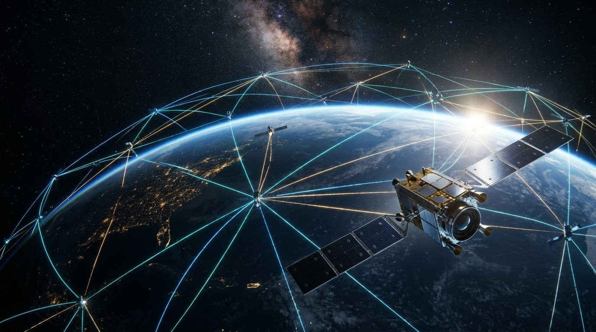

# AstroPHP

<p align="center">
  
</p>

<p align="center">
  <a href="https://github.com/wtfchristina/astro-php/actions"></a>
  
  
  
  
  <a href="LICENSE"></a>
</p>

---

**AstroPHP** is a numerical astrodynamics engine and LEO constellation propagation framework written in strictly-typed PHP 8.3+. It combines high-precision Cowell-method numerical integration with real-time 3D CesiumJS visualization, optical inter-satellite link (ISL) Doppler profiling, and multi-hop dynamic mesh routing.

---

## Core Capabilities

- **Cowell Numerical Propagator**: 4th-order Runge-Kutta (RK4) integration with sub-millisecond execution times.
- **Multi-Force Perturbation Models**:
  - **Two-Body Central Gravity**: WGS84 standard gravitational parameter ($\mu = 398600.4418\text{ km}^3/\text{s}^2$, $R_{\text{Earth}} = 6378.137\text{ km}$).
  - **Oblate Geopotential ($J_2$)**: Earth oblateness driving secular nodal precession ($\dot{\Omega}$) and argument of perigee rotation ($\dot{\omega}$).
  - **Atmospheric Drag**: Dynamic scale-height atmospheric density coupling ($\mathbf{a}_{\text{drag}} = -\frac{1}{2}\rho v_{\text{rel}}^2 \frac{C_D A}{m} \hat{\mathbf{v}}_{\text{rel}}$) with rotating Earth reference frames.
  - **Solar Radiation Pressure (SRP)**: Direct solar photon flux with dual cylindrical Earth eclipse shadow boundary detection.
- **Walker-Delta Constellation Engine**: Parametric generation of Walker-Delta ($T/P/F$) orbital shells with automated phase offsets and equatorial node spacing.
- **Optical Laser Inter-Satellite Links (ISL)**: Geometric line-of-sight ray tracing with Earth limb atmospheric buffers ($h_{\text{min}} \ge 100\text{ km}$) and acquisition distance thresholds.
- **Optical Doppler Analysis**: Line-of-sight relative velocity ($v_{\text{LOS}}$) derivation and carrier frequency shift ($\Delta f = -v_{\text{LOS}}/\lambda$) profiling for coherent laser terminals (1550 nm C-band and 1064 nm Nd:YAG).
- **Dijkstra Multi-Hop ISL Routing**: Real-time shortest path graph routing between ground stations (e.g., Phoenix PHX to Svalbard SGS) across dynamic cross-plane and intra-plane laser topologies.
- **3D CesiumJS & CZML Streaming**:
  - Continuous antimeridian-partitioned ground track geodesics.
  - Non-projected Euclidean 3D vectors (`arcType: NONE`) for dynamic RF ground downlinks and optical cross-links.
  - Live Server-Sent Events (SSE) telemetry feed (`public/stream.php`) delivering 10 Hz real-time state vectors.

---

## Architecture Layout

```text
astro-php/
├── bin/
│   ├── propagate.php             # Single-satellite Cowell propagator & CZML generator
│   ├── export_constellation.php  # 12-satellite Walker-Delta ISL mesh exporter
│   └── analyze_doppler.php       # Optical ISL Doppler shift & tracking loop analyzer
├── public/
│   └── stream.php                # High-frequency Server-Sent Events (SSE) telemetry endpoint
├── src/
│   ├── Constellation/
│   │   ├── DopplerAnalyzer.php          # LOS range-rate & Doppler frequency calculation
│   │   ├── InterSatelliteLink.php       # Line-of-sight occlusion & link distance validation
│   │   ├── RoutingEngine.php            # Dijkstra multi-hop shortest path graph solver
│   │   └── WalkerDeltaConstellation.php # Parametric T/P/F constellation generator
│   ├── Coordinate/
│   │   ├── KeplerianElements.php        # Classical orbital elements <-> Cartesian state vector
│   │   ├── StateVector.php              # 3D position & velocity vectors (km, km/s)
│   │   ├── Vector3.php                  # Euclidean vector operations (dot, cross, norm)
│   │   └── Wgs84Transformer.php         # ECI (inertial) <-> ECEF <-> Geodetic coordinates
│   ├── Force/
│   │   ├── AtmosphericDrag.php          # Exponential upper atmosphere drag deceleration
│   │   ├── CompositeForceModel.php      # Acceleration superposition vector accumulator
│   │   ├── EarthGravityModel.php        # Central two-body gravity + J2 perturbation
│   │   └── SolarRadiationPressure.php   # Solar flux acceleration + Earth shadow casting
│   ├── GroundStation/
│   │   ├── GroundStation.php            # Topocentric site location (lat, lon, alt)
│   │   └── PassPredictor.php            # Elevation mask threshold & AOS/LOS window solver
│   ├── Integrator/
│   │   └── RungeKutta4.php              # Fixed-step 4th-order Runge-Kutta numerical solver
│   └── Serializer/
│       └── CzmlWriter.php               # Cesium-compliant CZML packet serializer
├── tests/                               # PHPUnit test suites (100% passing)
├── viewer.html                          # Mission Control HUD & 3D WebGL Cesium viewer
└── composer.json

